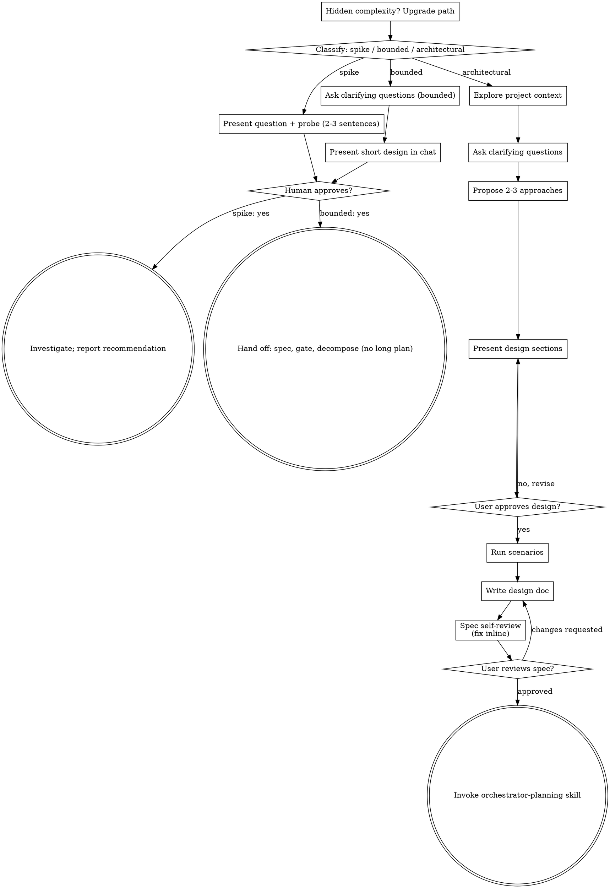

# Brainstorming Ideas Into Designs

Help turn ideas into fully formed designs and specs through natural collaborative dialogue.

Start by classifying how much process the request needs, then work
through your path: understand the context, refine the idea, present a
design, and get your human partner's approval.

## Establish Shared Understanding

The outcome of brainstorming is an understanding your human partner can
recognize and correct, grounded in what they want to accomplish.

1. **Discover intent.** Use the request and available context to identify
   the intended outcome, who it is for, and what success looks like. When
   that information is missing, ask one focused question about purpose or
   intended use before proposing features or an approach. Knowing the app
   genre does not tell you why your partner wants it. Gathering missing
   requirements does not ask them to authorize the task again.
2. **Write back your understanding.** Summarize the intended outcome,
   relevant constraints, and success criteria in a short note your partner
   can assess. Separate what they said from assumptions. Invite correction
   and incorporate their answer before treating this as the design brief.
3. **Carry intent into the design.** Preserve the agreed understanding in
   the selected path's design artifact: the written spec for architectural
   work, or the in-chat design/probe for bounded work and spikes. Check
   proposed features and technical choices against that understanding.

When the request already supplies the purpose and constraints, reflect
that understanding instead of asking the same questions again. Keep the
note concise; its accuracy and the opportunity to correct it matter.

## Your Altitude

You brainstorm as the ORCHESTRATOR of a feature, not as the engineer who
will write its code. Workers brainstorm and plan their own pieces later,
in the code. Your spec sits one level above theirs:

- **In the spec:** what changes for whom, the behaviour before and after,
  which components and teams take part and who owns what, how the parts
  talk to each other (the contract: what one side promises the other),
  what happens on failure, what is deliberately left out, the cost and
  risk, and how we will know it works.
- **Not in the spec:** files, functions, signatures, table and column
  layouts, SQL, lock order, index choices, retry formulas, test names.
  Those are the worker's decisions inside your contract. When you catch
  yourself designing one, write the requirement it serves instead
  ("one stop is reported once, however many sources report it") and
  leave the mechanism to the worker.
- **Reading code is allowed and often useful** — to check a fact the
  design rests on ("does this service already keep run history?"). Read
  to confirm or refute a fact, then come back up: the fact goes into the
  spec, the code you read does not.
- **Size check.** A spec for a well-scoped feature reads in a few minutes.
  If yours keeps growing with each revision, the design is drifting down a
  level or the scope is growing: cut back to the contract, or split the
  work into separate tasks.

## Context Before Questions

Before your first question to anyone, read what already exists:

1. Read the root of the fact tree of the task's repo — `INDEX.md` at the
   repo root — in full. Read it from your worktree or from origin, never
   from a possibly stale local mirror.
2. If the task touches the platform, also read the platform root
   `INDEX.md` of `lepsto/platform` in full (from origin, e.g.
   `gh api repos/lepsto/platform/contents/INDEX.md`).
3. Descend only the branches that touch the task: each fact links one
   level down; follow a link while it is relevant, stop when it is not.
4. If the repo has no `INDEX.md`, use its documentation entry point
   instead (CLAUDE.md, README, the docs index, then the code) and
   descend the same way. Never skip this step.
5. In the problem statement, add a short list "what already exists on
   this topic": one line per fact, each with a link to its source. If
   there was no fact tree, say so and name the sources you used.

Only then ask. A question whose answer is in those facts is not a
question — use the fact, and cite it.

<HARD-GATE>
Before taking any implementation action, including invoking an
implementation skill, writing product code, scaffolding, installing
product dependencies, or creating an external project, complete the
selected path's prerequisites:

- Spike: the human partner approves the question and probe.
- Bounded: the human partner approves the short in-chat design.
- Architectural: the human partner reviews and approves the written spec,
  then the decomposition plan. Conversational design approval only
  permits writing the spec; written-spec approval only permits invoking
  orchestrator-planning.

A reply approves the stage actually presented. Approval of an idea or
feature scope does not approve artifacts that do not exist yet. Resume
at the earliest incomplete stage; do not turn one approval into permission
to skip the rest of the selected path. Read-only project exploration is
allowed while those prerequisites remain incomplete.
</HARD-GATE>

## Three Paths

Before your first question, classify the request and say the
classification out loud — "this looks bounded, so I'll present a short
design here rather than write a spec" — so your human partner can
override it:

- **Spike** — a feasibility question ("can we...", "is it possible...",
  "quick and dirty is fine") whose output is an answer, not code you
  keep. Present the question and what you'll try in 2-3 sentences, get
  a nod, then find out as cheaply as correctness allows. No design
  doc, no spec file. Report findings as a recommendation; anything you
  built stays labeled throwaway.
- **Bounded** — a well-scoped change to code that already exists in
  this repo: a new flag, a small endpoint, a one-file fix.
  Understanding the kind of app is not enough — bounded means the flow
  you are changing is already here to read. If there is no existing
  flow to change, the task is not bounded. Ask the clarifying
  questions that matter, present a short design IN CHAT (a few
  sentences to a few short paragraphs), and STOP. Implementation
  starts only after your human partner says yes to that design — a
  bounded task's approval is as hard a gate as an architectural
  one. No spec file, no implementation plan document.
- **Architectural** — new projects, new subsystems, changes that
  restructure how components fit together or alter interfaces others
  depend on. Follow the full process: questions, approaches, sectioned
  design, written spec, then the orchestrator-planning skill.

When in doubt between two paths, take the heavier one. The ratchet is
one-way: hidden complexity discovered mid-task upgrades the path —
stop, say so, and step up. Nothing downgrades mid-task.

## Anti-Pattern: "Too Simple To Need Approval"

Every path ends with your human partner approving the required design
before implementation. A bounded change may need only two sentences in
chat. A new todo-list project is architectural and requires the written
spec and planning handoffs. Scale the artifact to the selected path;
complete that path's reviews before implementation.

## Red Flags

| Thought | Reality |
|---------|---------|
| "This is too simple to need a design" | Follow the selected path: a bounded change gets a short chat design; an architectural change gets the written spec and planning handoffs. |
| "I'll call it bounded and skip the spec" | Reaching for a label to skip work IS the doubt — take the heavier path. |
| "It's bounded and the design is obvious — I'll start while they read it" | The gate is the approval, not the design's length. Present, then stop until you hear yes. |
| "I understand this kind of app, so it's bounded" | Bounded measures the repo, not your familiarity. A new project has no existing flow — it is architectural. |
| "The spike works, so I'll keep the code" | A spike's output is an answer. Keeping the code is a new request — classify it. |
| "It grew, but I'm almost done — no need to re-classify" | Hidden complexity upgrades the path mid-task. Stop and say so. |
| "They approved the spike, so the follow-up change is approved too" | Each task gets its own classification and its own approval. |

## Checklist

Classify first, announce the path, then create a task for each item on
your path and complete them in order.

**Spike:**
1. **Explore project context** — enough to frame the probe
2. **Present question + probe plan** — 2-3 sentences
3. **Get approval** — a nod is enough
4. **Investigate** — as cheaply as correctness allows
5. **Report findings** — a recommendation; label anything built as throwaway

**Bounded:**
1. **Explore project context** — start with Context Before Questions (fact tree first); then docs and recent merged work; code only to check a fact
2. **Ask clarifying questions** — one at a time, the ones that matter
3. **Present short design in chat** — approach, which components/repos change and who owns them, how we verify
4. **Get approval** — STOP and wait for an explicit yes; presenting the design and starting in the same breath is skipping the gate
5. **Hand off** — store the short design as the spec, pass the gate, then decompose with orchestrator-planning; workers implement

**Architectural:**
1. **Explore project context** — start with Context Before Questions (fact tree first); then docs and recent merged work; code only to check a fact
2. **Offer the visual companion just-in-time** — NOT upfront. The first time a question would genuinely be clearer shown than described, offer it then (its own message); on approval its browser tab opens for you. If no visual question ever arises, never offer it. See the Visual Companion section below.
3. **Ask clarifying questions** — one at a time, understand purpose/constraints/success criteria
4. **Propose 2-3 approaches** — with trade-offs and your recommendation
5. **Present design** — in sections scaled to their complexity, get user approval after each section
6. **Run scenarios** — take 2-3 concrete scenarios (a real user, a real
   input, an edge case) and walk each through the proposed design step
   by step; note where the design does not cope. Fix the design or record
   the gap. The spec gets a "Scenarios" section with each walk-through and
   its gaps.
7. **Write design doc** — save to `docs/superpowers/specs/YYYY-MM-DD-<topic>-design.md` and commit
8. **Spec self-review** — quick inline check for placeholders, contradictions, ambiguity, scope (see below)
9. **User reviews written spec** — ask user to review the spec file before proceeding
10. **Transition to decomposition** — invoke the orchestrator-planning skill to split the spec into deliverables for workers

## Process Flow

**Terminal states are path-bound.** Architectural: the ONLY skill you
invoke after brainstorming is orchestrator-planning — never
frontend-design, mcp-builder, writing-plans or any other implementation
skill; those are for your workers. Bounded: after approval, store the
short design as the spec and hand it to workers through a short
decomposition; no long plan document. Spike: the terminal state is a
reported recommendation.

## The Process

The subsections below serve the bounded and architectural paths (a
spike stops at "present the probe, get a nod"). Sections from
**Exploring approaches** onward are architectural-path depth — for
bounded work, context plus a few questions plus a short in-chat design
is the whole process.

**Understanding the idea:**

- Check out the current project state first (fact tree, docs, recent merged work; code only to check a fact)
- Before asking detailed questions, assess scope: if the request describes multiple independent subsystems (e.g., "build a platform with chat, file storage, billing, and analytics"), flag this immediately. Don't spend questions refining details of a project that needs to be decomposed first.
- If the project is too large for a single spec, help the user decompose into sub-projects: what are the independent pieces, how do they relate, what order should they be built? Then brainstorm the first sub-project through the normal design flow. Each sub-project gets its own spec → plan → implementation cycle.
- For appropriately-scoped projects, ask questions one at a time to refine the idea
- Prefer multiple choice questions when possible, but open-ended is fine too
- Only one question per message - if a topic needs more exploration, break it into multiple questions
- Focus on understanding: purpose, constraints, success criteria

**Exploring approaches:**

- Propose 2-3 different approaches with trade-offs
- Present options conversationally with your recommendation and reasoning
- Lead with your recommended option and explain why
- YAGNI ruthlessly - remove unnecessary features from every approach and design

**Presenting the design:**

- Once you believe you understand what you're building, present the design
- Scale each section to its complexity: a few sentences if straightforward, up to 200-300 words if nuanced
- Ask after each section whether it looks right so far
- Cover: behaviour, components and who owns them, how they interact, failure behaviour, how we verify — at the level of contracts between components, not their internals (see "Your Altitude")
- Be ready to go back and clarify if something doesn't make sense

**Design for isolation and clarity:**

- Break the system into smaller units that each have one clear purpose, communicate through well-defined interfaces, and can be understood and tested independently
- For each unit, you should be able to answer: what does it do, how do you use it, and what does it depend on?
- Can someone understand what a unit does without reading its internals? Can you change the internals without breaking consumers? If not, the boundaries need work.
- Smaller, well-bounded units also make better worker tasks: each one fits one worker, one branch and one PR, and can be checked on its own.

**Working in an existing product:**

- Learn the current responsibilities before proposing changes: which component and which team owns what today. Follow them; a new connection between components is a decision to surface, not a detail.
- Where the current shape gets in the way of the goal, say so in the design as a requirement; how to restructure the code is the worker's call.
- Don't propose unrelated refactoring. Stay focused on what serves the current goal.

## After the Design (architectural path)

**Documentation:**

- Write the validated design (spec) to `docs/superpowers/specs/YYYY-MM-DD-<topic>-design.md`
  - (User preferences for spec location override this default)
- The spec includes a "Scenarios" section: 2-3 concrete walk-throughs, step by step, and where the design does not cope.
- Use elements-of-style:writing-clearly-and-concisely skill if available
- Commit the design document to git

**Spec Self-Review:**
After writing the spec document, look at it with fresh eyes:

1. **Placeholder scan:** Any "TBD", "TODO", incomplete sections, or vague requirements? Fix them.
2. **Internal consistency:** Do any sections contradict each other? Does the architecture match the feature descriptions?
3. **Scope check:** Is this focused enough for a single implementation plan, or does it need decomposition?
4. **Ambiguity check:** Could any requirement be interpreted two different ways? If so, pick one and make it explicit.

5. **Altitude check:** Does any section design a mechanism (files, schema, locks, signatures) instead of stating a requirement or a contract? Lift it up a level.

Fix any issues inline. No need to re-review — just fix and move on.

This self-review is the only review the spec gets before the human or cto
reads it. Do not hand the spec to cto or another agent to read "as the
builder" or "as an implementer": that pulls the review down to code level,
and every round adds detail nobody needs yet. cto answers questions about
the product and the decisions; the implementation is checked later, in the
workers' PRs.

**User Review Gate:**
After the spec review loop passes, ask the user to review the written spec before proceeding:

> "Spec written and committed to `<path>`. Please review it and let me know if you want to make any changes before we start writing out the implementation plan."

Wait for the user's response. If they request changes, make them and re-run the spec review loop. Only proceed once the user approves.

**Implementation:**

- Invoke the orchestrator-planning skill to decompose the spec into deliverables for workers
- Do NOT invoke any other skill. orchestrator-planning is the next step; each worker writes its own detailed implementation plan later.

## Visual Companion

A browser-based companion for showing mockups, diagrams, and visual options during brainstorming. Available as a tool — not a mode. Accepting the companion means it's available for questions that benefit from visual treatment; it does NOT mean every question goes through the browser.

**Offering the companion (just-in-time):** Do NOT offer it upfront. Wait until a question would genuinely be clearer shown than told — a real mockup / layout / diagram question, not merely a UI *topic*. The first time that happens, offer it then, as its own message:
> "This next part might be easier if I show you — I can put together mockups, diagrams, and comparisons in a browser tab as we go. It's still new and can be token-intensive. Want me to? I'll open it for you."

**This offer MUST be its own message.** Only the offer — no clarifying question, summary, or other content. Wait for the user's response. If they accept, start the server with `--open` so their browser opens to the first screen automatically. If they decline, continue text-only and don't offer again unless they raise it.

**Per-question decision:** Even after the user accepts, decide FOR EACH QUESTION whether to use the browser or the terminal. The test: **would the user understand this better by seeing it than reading it?**

- **Use the browser** for content that IS visual — mockups, wireframes, layout comparisons, architecture diagrams, side-by-side visual designs
- **Use the terminal** for content that is text — requirements questions, conceptual choices, tradeoff lists, A/B/C/D text options, scope decisions

A question about a UI topic is not automatically a visual question. "What does personality mean in this context?" is a conceptual question — use the terminal. "Which wizard layout works better?" is a visual question — use the browser.

If they agree to the companion, read the detailed guide before proceeding:
`.claude/skills/orchestrator-brainstorming/visual-companion.md`
